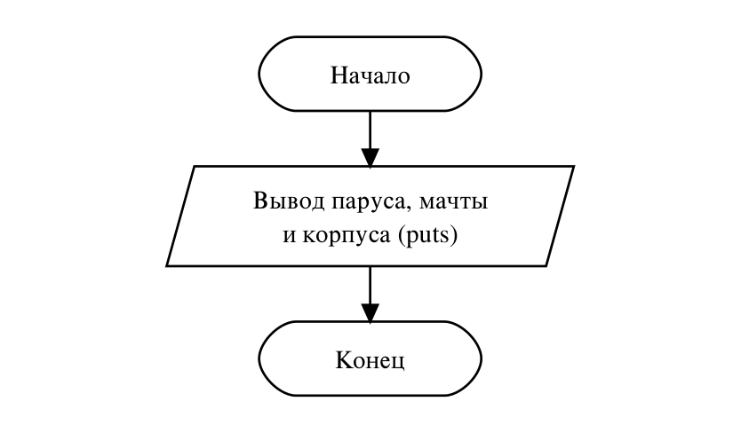

# Домашнее задание к работе №1
Вариант 15

## Условие задачи
Создайте проект и напишите программу, которая рисует кораблик (домик, …) с помощью символов. Убедитесь, что файл сохранен в кодировке UTF-8.

## 1. Алгоритм и блок-схема
### Алгоритм:
1. Начало.
2. Построчно вывести рисунок функцией **puts**: парус, мачту и корпус. Обратная косая черта в строке записывается как `\\`, потому что одиночная `\` начинает управляющий символ (например, `\n`).
3. Конец.

### Блок-схема:


## 2. Реализация программы
```c
#include <stdio.h>

int main() {
    puts("    |\\");
    puts("    | \\");
    puts("____|__\\___");
    puts("\\_________/");
    return 0;
}
```

## 3. Результаты работы программы
Вывод программы:
```
    |\
    | \
____|__\___
\_________/
```

## 4. Информация о разработчике
Файко Андрей Юрьевич, бТИИ-262
